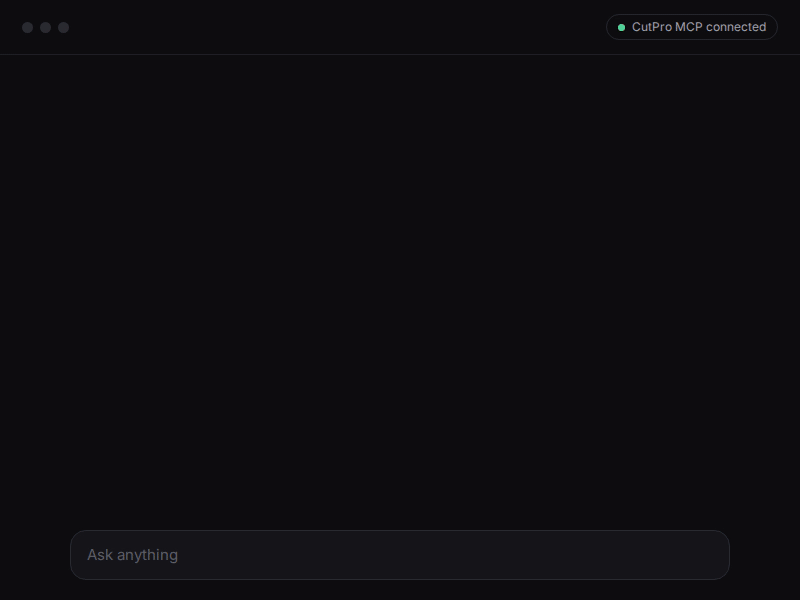

<div align="center">


# CutPro MCP

**Make videos, images, music and voices with the best AI models, clip long videos into shorts and post them everywhere. All from your chat.**

[](https://www.npmjs.com/package/@cutpro/mcp)
[](https://www.npmjs.com/package/@cutpro/mcp)
[](https://registry.modelcontextprotocol.io)
[](LICENSE)

[Quick start](#quick-start) · [Examples](examples) · [Tools](#tools) · [Docs](https://cut.pro/docs/mcp)



</div>

## What it does

- 🎬 **Generate** videos, images, music, voices, talking avatars and 3D with Veo, Kling, Seedance, Nano Banana, GPT Image, Suno and more
- ✂️ **Clip** long videos and live streams into captioned shorts
- 📲 **Post** to TikTok, Instagram, YouTube, Facebook, Threads, LinkedIn, Pinterest and Bluesky, through each official API
- 🧑 **Create AI characters** that look the same in every photo and video
- 📝 **Transcribe** any audio or video into SRT, VTT, text or JSON

Every paid call shows the exact price first and waits for your yes.

## Quick start

**ChatGPT, Claude.ai and other web clients:** add a custom connector with this URL and sign in. No API key needed.

```
https://mcp.cut.pro
```

**Claude Code:**

```bash
claude mcp add cutpro --env CUTPRO_API_KEY=<your-api-key> -- npx -y @cutpro/mcp@latest
```

Get a key at [cut.pro/studio/me/api-keys](https://cut.pro/studio/me/api-keys). One click for other clients, then add the key to the server's `env`:

[](https://insiders.vscode.dev/redirect?url=vscode%3Amcp%2Finstall%3F%257B%2522name%2522%253A%2522cutpro%2522%252C%2522command%2522%253A%2522npx%2522%252C%2522args%2522%253A%255B%2522-y%2522%252C%2522%2540cutpro%252Fmcp%2540latest%2522%255D%257D)
[](https://cursor.com/en/install-mcp?name=cutpro&config=eyJjb21tYW5kIjoibnB4IiwiYXJncyI6WyIteSIsIkBjdXRwcm8vbWNwQGxhdGVzdCJdfQ)
[](https://lmstudio.ai/install-mcp?name=cutpro&config=eyJjb21tYW5kIjoibnB4IiwiYXJncyI6WyIteSIsIkBjdXRwcm8vbWNwQGxhdGVzdCJdfQ)
[](goose://extension?cmd=npx&arg=-y&arg=%40cutpro%2Fmcp%40latest&id=cutpro&name=CutPro&description=AI%20video%20clipping%20via%20the%20CutPro%20API)

<details>
<summary>Claude Desktop, Cursor, Windsurf, Cline, Gemini CLI, Codex</summary>

Most clients take this JSON (Claude Desktop: Settings, Developer, Edit Config):

```json
{
	"mcpServers": {
		"cutpro": {
			"command": "npx",
			"args": ["-y", "@cutpro/mcp@latest"],
			"env": { "CUTPRO_API_KEY": "<your-api-key>" }
		}
	}
}
```

Gemini CLI:

```bash
gemini mcp add cutpro npx -y @cutpro/mcp@latest -e CUTPRO_API_KEY=<your-api-key>
```

Codex, in `~/.codex/config.toml`:

```toml
[mcp_servers.cutpro]
command = "npx"
args = ["-y", "@cutpro/mcp@latest"]
env = { "CUTPRO_API_KEY" = "<your-api-key>" }
```

Claude Code plugin, with a skill that teaches the CutPro workflows:

```bash
claude plugin marketplace add getcutpro/mcp
claude plugin install cutpro@cutpro
```

</details>

## Try asking

> Make a 9:16 ad of my sneakers with Veo and schedule it on TikTok for Friday 6 pm

> Clip yesterday's podcast into 5 shorts with captions

> Make this photo of me say the script below in Spanish

Any language works. Prefer code? [examples/](examples) has the same flows as plain Node.js scripts.

## Tools

One tool per [CutPro API](https://cut.pro/docs/reference) endpoint, built from the live spec: a new endpoint becomes a tool within ten minutes, with no release. Clients with [MCP Apps](https://modelcontextprotocol.io/extensions/apps/overview) show results in an inline player.

<details>
<summary>See all tools</summary>

<!-- tools:start -->

99 tools and 10 prompts, generated from the live API spec and the server.

#### Prompts

Ready-made requests your client offers as shortcuts (the `/` menu in Claude).

| Prompt              | What it does                                                                                   |
| ------------------- | ---------------------------------------------------------------------------------------------- |
| `generate_video`    | Turn an idea into a video with Veo, Kling, Seedance, Wan or any other model.                   |
| `product_ad`        | An ad image of your product, animated into a vertical video ready to post.                     |
| `make_music`        | A song with lyrics, or an instrumental for a video, with Suno, Eleven Music, MiniMax and more. |
| `voiceover`         | A natural voice reading your script, in any language, ready to put in a video.                 |
| `talking_avatar`    | A person in a photo speaking your script with a natural voice, in any language.                |
| `edit_image`        | Upscale, remove the background, erase objects or change anything in a photo.                   |
| `make_3d`           | A 3D model (GLB) from a photo or a description, for games, AR or product pages.                |
| `create_persona`    | A realistic person that stays the same in every photo and video.                               |
| `clip_and_schedule` | The best moments of a long video, rendered and scheduled one per day.                          |
| `transcribe`        | Timed captions of a video or audio, plus a short summary.                                      |

#### Account: workspace

| Tool            | What it does          | Notes |
| --------------- | --------------------- | ----- |
| `get_workspace` | Get current workspace |       |

#### Account: credits

| Tool                  | What it does                | Notes |
| --------------------- | --------------------------- | ----- |
| `get_balance`         | Get balance                 |       |
| `get_balance_history` | Get credit history          |       |
| `list_credit_offers`  | List plans and credit packs |       |

#### Clipping: source videos

| Tool                              | What it does                | Notes             |
| --------------------------------- | --------------------------- | ----------------- |
| `create_video_upload`             | Start an upload             | local server only |
| `complete_video_multipart_upload` | Finalize a multipart upload | local server only |
| `abort_video_multipart_upload`    | Discard a multipart upload  | local server only |
| `complete_video_upload`           | Complete an upload          | local server only |
| `list_videos`                     | List videos                 |                   |
| `delete_video`                    | Delete a video              |                   |

#### Clipping: clip a video

| Tool                | What it does                | Notes |
| ------------------- | --------------------------- | ----- |
| `create_submission` | Submit a video for clipping |       |
| `analyze_video`     | Analyze a video             |       |
| `list_submissions`  | List submissions            |       |
| `get_submission`    | Get submission              |       |
| `delete_submission` | Delete submission           |       |
| `retry_submission`  | Retry a failed submission   |       |

#### Clipping: clips

| Tool                      | What it does               | Notes                   |
| ------------------------- | -------------------------- | ----------------------- |
| `apply_template`          | Apply template to clips    |                         |
| `list_clips`              | List generated clips       | opens the CutPro player |
| `delete_clip`             | Delete a clip              |                         |
| `download_clip_subtitles` | Download a clip's captions |                         |
| `render_clip`             | Render a clip              | opens the CutPro player |

#### Live clipping: monitored channels

| Tool                       | What it does                      | Notes |
| -------------------------- | --------------------------------- | ----- |
| `list_monitors`            | List monitored channels           |       |
| `create_monitor`           | Monitor a channel                 |       |
| `get_monitor`              | Get a monitored channel           |       |
| `update_monitor`           | Update a monitor                  |       |
| `delete_monitor`           | Stop watching a channel           |       |
| `start_monitor`            | Start monitoring                  |       |
| `stop_monitor`             | Stop monitoring                   |       |
| `list_broadcasts`          | List broadcasts of a live monitor |       |
| `list_broadcast_clips`     | List clips of a broadcast         |       |
| `apply_broadcast_template` | Apply template to broadcast clips |       |
| `render_broadcast_clip`    | Render a broadcast clip           |       |

#### Editing: templates

| Tool             | What it does   | Notes |
| ---------------- | -------------- | ----- |
| `list_templates` | List templates |       |

#### Editing: export to MP4

| Tool                   | What it does              | Notes                   |
| ---------------------- | ------------------------- | ----------------------- |
| `get_render_limits`    | Get render quota          |                         |
| `create_render`        | Render an edit            |                         |
| `list_renders`         | List renders              |                         |
| `create_bulk_download` | Start a bulk download     |                         |
| `get_bulk_download`    | Get bulk download status  |                         |
| `get_render`           | Get render status         | opens the CutPro player |
| `delete_render`        | Cancel or delete a render |                         |
| `download_render`      | Get render download URL   | opens the CutPro player |

#### Posting: connected accounts

| Tool                  | What it does                       | Notes |
| --------------------- | ---------------------------------- | ----- |
| `list_connections`    | List connections                   |       |
| `get_connection_link` | Get the link to connect an account |       |
| `get_connection`      | Get a connection                   |       |

#### Posting: social media posts

| Tool               | What it does        | Notes |
| ------------------ | ------------------- | ----- |
| `create_post`      | Create a post       |       |
| `list_posts`       | List posts          |       |
| `get_post`         | Get a post          |       |
| `cancel_post`      | Cancel a post       |       |
| `update_post`      | Update a post       |       |
| `publish_post`     | Trigger publish     |       |
| `retry_post_item`  | Retry a failed item |       |
| `delete_post_item` | Delete a post item  |       |

#### Transcription

| Tool                          | What it does                               | Notes             |
| ----------------------------- | ------------------------------------------ | ----------------- |
| `create_transcription_upload` | Start an upload                            | local server only |
| `create_transcription`        | Transcribe a media file                    |                   |
| `list_transcriptions`         | List transcriptions                        |                   |
| `get_transcription`           | Get transcription status                   |                   |
| `delete_transcription`        | Delete a transcription                     |                   |
| `get_transcription_cues`      | Get the transcript as JSON                 |                   |
| `download_transcription`      | Download the transcript as a subtitle file |                   |

#### AI characters

| Tool                             | What it does                                 | Notes                                               |
| -------------------------------- | -------------------------------------------- | --------------------------------------------------- |
| `get_persona_catalog`            | Get traits, prices and limits                |                                                     |
| `list_persona_presets`           | List ready-made characters                   |                                                     |
| `create_persona_from_preset`     | Create a persona from a ready-made character | opens the CutPro player                             |
| `favorite_persona_preset`        | Star a ready-made character                  |                                                     |
| `list_personas`                  | List personas                                | opens the CutPro player                             |
| `create_persona`                 | Create a persona                             | opens the CutPro player                             |
| `upload_persona_face`            | Upload a reference photo                     | local server only                                   |
| `quote_persona_swap`             | Price a swap video                           |                                                     |
| `create_persona_source_upload`   | Upload a source video                        | local server only                                   |
| `complete_persona_source_upload` | Complete a source video upload               | local server only                                   |
| `get_persona`                    | Get a persona                                | opens the CutPro player                             |
| `delete_persona`                 | Delete a persona                             |                                                     |
| `regenerate_persona`             | Regenerate or edit the persona photo         | opens the CutPro player                             |
| `restore_persona_version`        | Restore a persona version                    |                                                     |
| `rate_persona_version`           | Rate a persona photo                         |                                                     |
| `rate_persona_video`             | Rate a persona video                         |                                                     |
| `save_persona`                   | Save or rename a persona                     |                                                     |
| `create_persona_video`           | Create a persona video                       | spends credits, asks first, opens the CutPro player |
| `list_persona_videos`            | List a persona's videos                      | opens the CutPro player                             |
| `get_persona_video`              | Get a persona video                          | opens the CutPro player                             |
| `read_persona_shot_product`      | Read a product from its page link            |                                                     |
| `upload_persona_shot_photo`      | Upload a product photo                       | local server only                                   |
| `create_persona_shot`            | Create a persona photo                       | spends credits, asks first                          |
| `list_persona_shots`             | List a persona's photos                      |                                                     |
| `get_persona_shot`               | Get a persona photo                          |                                                     |

#### Generate with AI: models

| Tool                   | What it does                        | Notes |
| ---------------------- | ----------------------------------- | ----- |
| `list_models`          | List every AI model                 |       |
| `list_featured_models` | List the models worth starting with |       |

#### Generate with AI: images, videos, sound and 3D

| Tool                            | What it does                                      | Notes                                               |
| ------------------------------- | ------------------------------------------------- | --------------------------------------------------- |
| `get_generation_webhook_secret` | Get the secret that signs generation webhooks     |                                                     |
| `upload_generation_image`       | Upload a reference image                          | local server only                                   |
| `upload_generation_media`       | Upload an image, video or sound to generate from  | local server only                                   |
| `quote_generation`              | Price a generation without generating             |                                                     |
| `create_generation`             | Generate an image, a video, a sound or a 3D model | spends credits, asks first, opens the CutPro player |
| `list_generations`              | List generations                                  | opens the CutPro player                             |
| `get_generation`                | Get a generation                                  | opens the CutPro player                             |
| `delete_generation`             | Delete a generation                               |                                                     |
| `open_generation_edit`          | Open a generated or persona video to edit or post |                                                     |
| `improve_generation_prompt`     | Rewrite a short request in more detail            |                                                     |
| `rate_generation`               | Rate a generation                                 |                                                     |
| `request_generation_refund`     | Ask for the credits of a generation back          |                                                     |
| `download_generation`           | Get the download link of a generation             |                                                     |

<!-- tools:end -->

</details>

<details>
<summary>Configuration and self-hosting</summary>

| Variable                 | Description                                                                 |
| ------------------------ | --------------------------------------------------------------------------- |
| `CUTPRO_API_KEY`         | Your CutPro API key. Required for the local (stdio) server.                 |
| `CUTPRO_WORKSPACE_ID`    | Selects the workspace for multi-workspace keys.                             |
| `CUTPRO_API_URL`         | Override the API base URL. Defaults to `https://api.cut.pro/api/v1`.        |
| `CUTPRO_MCP_AUTO_UPDATE` | `0` keeps the installed version instead of switching to the newest release. |

The local server checks npm on start and hands the session to a newer release, even from a stale `npx` cache. The hosted one is always current.

To host the remote yourself (Streamable HTTP with OAuth 2.1, DCR and CIMD):

| Variable                      | Description                                                                                              |
| ----------------------------- | -------------------------------------------------------------------------------------------------------- |
| `MCP_TRANSPORT=http` / `PORT` | Serve Streamable HTTP at the root instead of stdio.                                                      |
| `MCP_OAUTH=1`                 | Enable OAuth (discovery, DCR, PKCE) for browser clients.                                                 |
| `MCP_PUBLIC_URL`              | Public endpoint, e.g. `https://mcp.cut.pro`. Its origin becomes the OAuth issuer.                        |
| `MCP_REDIS_URL`               | Keep OAuth state in Redis so it survives restarts. Without it, state lives in memory.                    |
| `CUTPRO_APP_URL`              | Where the consent screen lives. Defaults to `https://cut.pro`.                                           |
| `OPENAI_APPS_CHALLENGE`       | Domain verification token from the OpenAI plugin portal, served at `/.well-known/openai-apps-challenge`. |

```bash
MCP_TRANSPORT=http PORT=8787 MCP_OAUTH=1 MCP_PUBLIC_URL=https://mcp.cut.pro npx -y @cutpro/mcp@latest
```

</details>

---

[Docs](https://cut.pro/docs/mcp) · [Changelog](CHANGELOG.md) · [Contributing](CONTRIBUTING.md) · [Security](SECURITY.md) · MIT License
